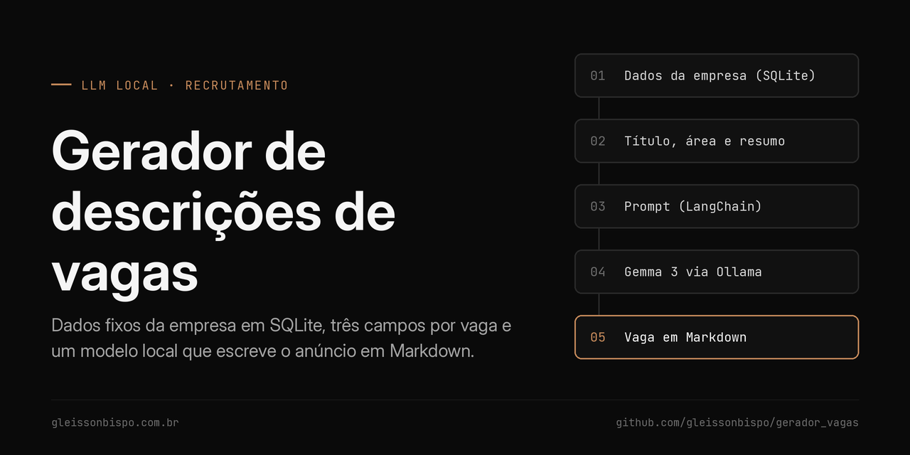
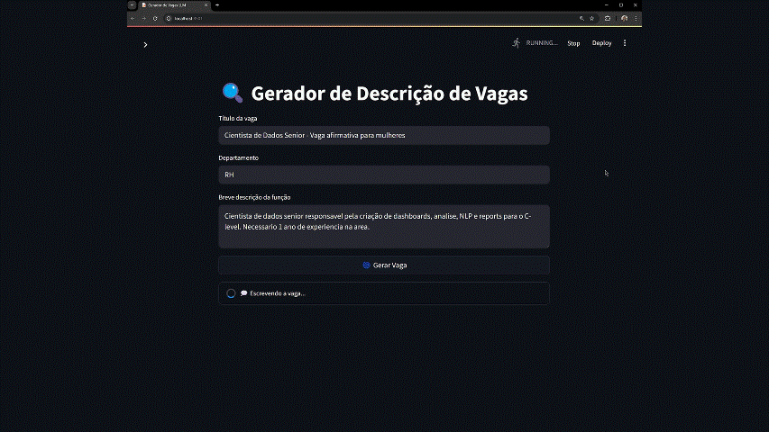
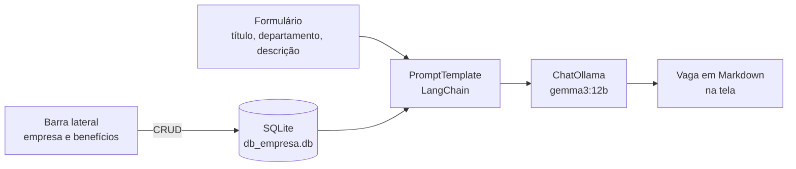

# Gerador de descrições de vagas com LLM local

Aplicação em Streamlit que escreve a descrição de uma vaga a partir de três campos (título, departamento e um resumo da função) e dos dados fixos da empresa, guardados em SQLite. O texto é gerado por um modelo rodando na própria máquina, via Ollama.



## Problema

Descrição de vaga costuma ser escrita do zero a cada abertura. O resultado varia de recrutador para recrutador: missão e valores da empresa aparecem de um jeito em cada anúncio, a lista de benefícios fica desatualizada e a estrutura do texto muda a cada vaga.

## Solução

O que é fixo fica cadastrado uma vez: nome da empresa, missão, visão, valores e benefícios. Para cada vaga nova, quem recruta informa só o que muda. O app monta um prompt com as duas partes e pede ao modelo um texto em Markdown com estrutura fechada:

1. Título e departamento
2. Sobre a empresa
3. Visão geral da função
4. Responsabilidades (4 a 6 itens)
5. Requisitos (4 a 6 itens)
6. Diferenciais (3 a 5 itens)
7. Benefícios e cultura

Como o modelo roda localmente, nenhum dado da empresa sai da máquina.

## Arquitetura



| Arquivo | Papel |
|---|---|
| `gerador_vaga.py` | Interface Streamlit, prompt e chamada ao modelo |
| `gerencia_db.py` | Criação do banco SQLite e funções de leitura e escrita (empresa e benefícios) |
| `requirements.txt` | Dependências Python |

O banco é criado na primeira execução com uma empresa de exemplo (Acme Corporation) e quatro benefícios, para o app já abrir funcionando.

## Como rodar

Pré-requisitos: Python 3.10 ou superior e o [Ollama](https://ollama.com) instalado.

```bash
# 1. Baixe o modelo (cerca de 8 GB)
ollama pull gemma3:12b

# 2. Clone e instale
git clone https://github.com/gleissonbispo/gerador_vagas.git
cd gerador_vagas
python -m venv .venv && source .venv/bin/activate   # no Windows: .venv\Scripts\activate
pip install -r requirements.txt

# 3. Suba a aplicação
streamlit run gerador_vaga.py
```

O app abre em `http://localhost:8501`.

Para usar outro modelo, troque o nome em `gerador_vaga.py` (`ChatOllama(model="gemma3:12b")`). Em máquina com pouca memória, `gemma3:4b` funciona, com texto menos consistente.

## Exemplo de uso

1. Na barra lateral, ajuste nome, missão, visão e valores da empresa e clique em **Salvar**.
2. Ainda na barra lateral, adicione ou remova benefícios (ex.: `Vale-refeição - R$ 35,00 dia`).
3. Na tela principal, preencha:
   - **Título da vaga:** Analista de People Analytics
   - **Departamento:** Recursos Humanos
   - **Breve descrição da função:** Construir indicadores de turnover e headcount, apoiar os BPs com análises e manter os dashboards do RH.
4. Clique em **Gerar Vaga**. A descrição aparece renderizada em Markdown, pronta para copiar.

## Limitações

- O texto gerado precisa de revisão humana antes de publicar. O modelo pode inventar requisitos que não fazem sentido para a vaga.
- O tom de voz está fixo no prompt ("apaixonante, convidativo e inclusivo"). Para mudar, é preciso editar o código.
- Suporta uma única empresa por banco.
- As vagas geradas não ficam salvas e não há botão de download: o uso é copiar e colar.
- Não há testes automatizados.

## Próximos passos

- Guardar o histórico de vagas geradas.
- Exportar em `.md` e `.docx`.
- Deixar tom de voz e modelo configuráveis pela interface.
- Checar linguagem enviesada no texto antes de exibir.

## Autor

Gleisson Bispo · [gleissonbispo.com.br](https://gleissonbispo.com.br) · [LinkedIn](https://www.linkedin.com/in/gleissonbispo)
